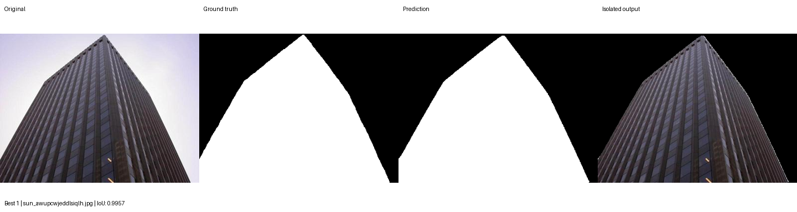
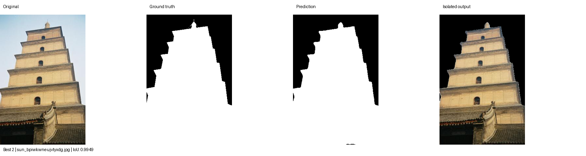
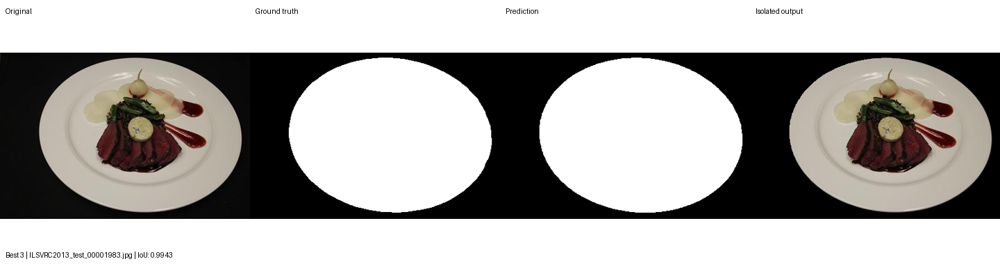
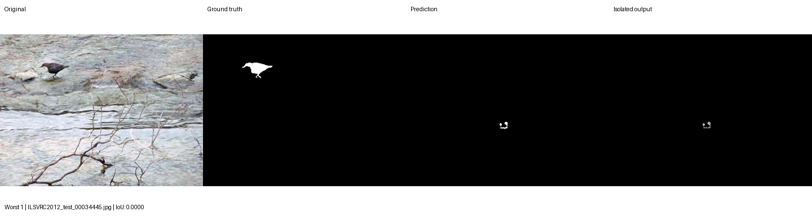
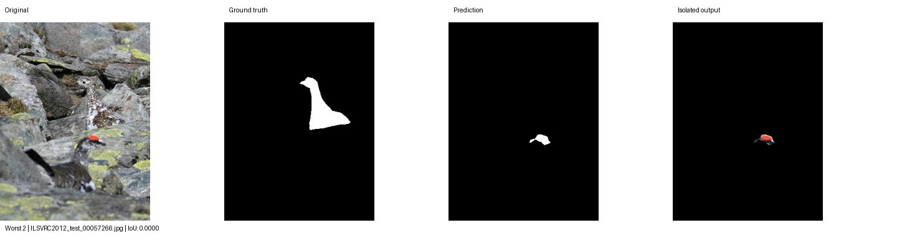
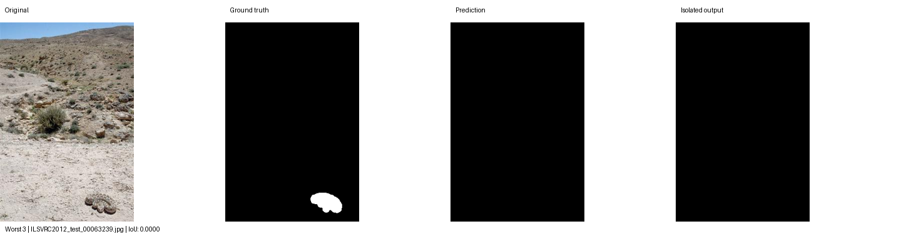
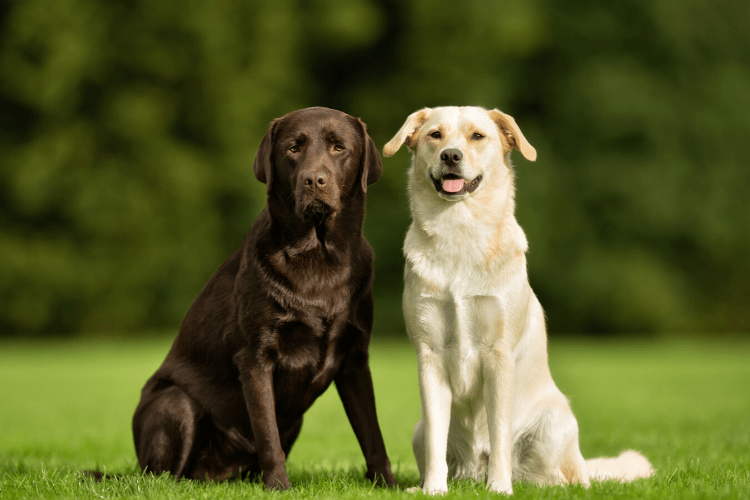
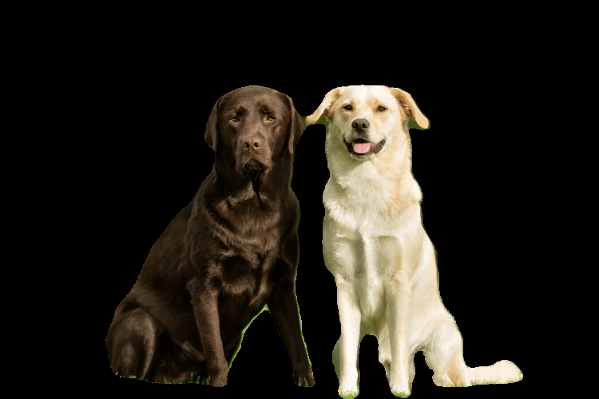

# VisionExtract

VisionExtract isolates the main subject in an image by predicting a foreground mask with a U-Net segmentation model (ResNet-34 encoder). The mask is applied to the original image, leaving the subject on a black background. The project includes data preparation, training, test evaluation, a Streamlit interface, and a command-line inference tool.

## Setup

Requires Python 3. Install the project dependencies in a virtual environment:

```bash
python -m venv .venv
```

Activate the environment, then install the dependencies:

```bash
# Windows PowerShell
.\.venv\Scripts\Activate.ps1

# macOS/Linux
source .venv/bin/activate

python -m pip install --upgrade pip
pip install -r requirements.txt
```

The trained model weights are **not stored in this repository**. Train the model to generate `best_model.pth` before running evaluation, the app, or inference.

## Data

VisionExtract uses DUTS-TR for training/validation and DUTS-TE for testing. These datasets were used instead of COCO because they provide masks for the main subject, matching the project's subject-isolation goal.

Place the datasets under `dataset/` with this layout:

```text
dataset/
├── DUTS-TR/
│   ├── DUTS-TR-Image/
│   └── DUTS-TR-Mask/
└── DUTS-TE/
    ├── DUTS-TE-Image/
    └── DUTS-TE-Mask/
```

Images should be JPG files and their corresponding binary masks should be PNG files with matching file-name stems. Dataset files are excluded from the repository.

## Prepare the data

From the project root, run:

```bash
python prepare_data.py
```

This matches images to masks, creates a deterministic 90/10 training/validation split from DUTS-TR, and uses matched DUTS-TE pairs as the test split. The resulting splits are written to `dataset/splits.json`.

## Train

```bash
python train.py
```

Training resizes inputs to 256×256 and saves the best validation checkpoint as `best_model.pth` in the project root.

## Evaluate

```bash
python evaluate.py
```

Evaluation reports test metrics averaged from each image's individual scores. It also writes three highest-IoU and three lowest-IoU example panels to `docs/`. Each panel shows the original image, ground-truth mask, predicted mask, and isolated output.

### Test results

| Metric | Per-image average |
| --- | ---: |
| IoU | 0.745 |
| Dice | 0.826 |
| Precision | 0.830 |
| Recall | 0.876 |
| Accuracy | 0.955 |

### Example results

Best-IoU examples:

| Best 1 | Best 2 | Best 3 |
| --- | --- | --- |
|  |  |  |

Worst-IoU examples:

| Worst 1 | Worst 2 | Worst 3 |
| --- | --- | --- |
|  |  |  |

## Run the app

After training and placing `best_model.pth` in the project root, run:

```bash
streamlit run app.py
```

Upload an image in the browser to preview and download the isolated subject.

### Before and after

| Input | Isolated output |
| --- | --- |
|  |  |

## Use `infer.py`

Pass an input image and destination path to create an isolated image with a black background:

```bash
python infer.py path/to/input.jpg path/to/output.png
```

Optionally add `--clean` to keep only the largest connected region in the predicted mask:

```bash
python infer.py path/to/input.jpg path/to/output.png --clean
```

## Limitations

- Very small subjects or subjects that blend into the background can produce empty or incomplete masks. See the worst-IoU examples above.
- `--clean` retains only the largest connected region, so it can drop a separate smaller subject.
- Masks are predicted at 256×256 resolution, so isolated output edges can show a slight fringe.
- Model weights are not stored in the repository; a trained `best_model.pth` file is required to evaluate or run inference.
